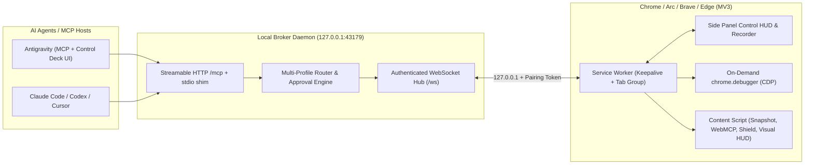

<div align="center">

# Chrome Browser MCP

**Next-gen Chrome Extension (MV3) & MCP v2 Server for real-session AI browser use**

Hybrid Content Script + On-Demand CDP · Native WebMCP · Prompt-Injection Shield · Workflow Recorder · Multi-Profile Broker · Antigravity Control Deck MCP App

**English** · [Русский](./README.ru.md) · [简体中文](./README.zh-CN.md)

[](https://github.com/szybnev/chrome-browser-mcp/actions/workflows/ci.yml)
[](https://modelcontextprotocol.io)
[](./packages/extension)
[](./packages/extension/src/background/service-worker.ts)
[](./package.json)
[](./tsconfig.base.json)
[](./PRIVACY.md)
[](./packages/protocol/src/shield.ts)
[](./LICENSE)
[](https://github.com/szybnev/chrome-browser-mcp/stargazers)

</div>

---

## Why Chrome Browser MCP?

Most browser-use extensions force painful trade-offs: they either spin up logged-out headless browsers, permanently show Chrome's yellow debugger banner, burn 30K+ tokens per step with raw screenshots/HTML, conflict when two agents run simultaneously, or expose every private tab to prompt injection.

| Capability | Chrome Browser MCP | Typical Browser Relay / Visual Extensions |
| :--- | :--- | :--- |
| **Real Logged-In Sessions** | Works in your daily Chrome / Arc / Brave / Edge profile — no `--remote-debugging-port` hacks | Often needs separate debug profile or loses sessions |
| **Hybrid Adaptive Engine** | Silent Content Script + WebMCP by default; **on-demand `chrome.debugger` CDP** with idle auto-detach & DevTools-open fallback | Always-on yellow debugger banner or brittle synthetic-only clicks |
| **Token Efficiency** | Pruned a11y/DOM snapshot with short refs (`e1`, `e2`…), **incremental diffs**, and **batch `browser_act`** (multi-step forms in 1 round-trip) | Full DOM/screenshot every step; 1 LLM call per click |
| **Multi-Agent & Multi-Profile** | Shared local Broker Daemon (Streamable HTTP + auto-spawn `stdio` shim with lease lifecycle) multiplexing multiple agents & browsers | Single-client port conflicts (`EADDRINUSE`) |
| **Security & Control** | Dedicated colored **AI Agent Tab Group**, editable domain blocklist, risky-action approval gates, **Prompt-Injection Shield**, instant `Alt+Shift+P` Pause | Full unguarded browser access or constant friction |
| **WebMCP & Workflow Recorder** | Native `navigator.modelContext` tool discovery + “Show by hand” workflow recorder with password masking | Manual clicking only |
| **Antigravity MCP App UI** | Built-in **Browser Control Deck** (`ui://chrome-browser/deck.html`) in `aux_pane` & `global` views | Text-only tool output |

---

## Architecture



---

## Quick Start

### 1. Build from source
```bash
git clone https://github.com/szybnev/chrome-browser-mcp.git
cd chrome-browser-mcp
pnpm install
pnpm build
```

### 2. Load the Chrome Extension (MV3)
1. Open `chrome://extensions` and enable **Developer mode**.
2. Click **Load unpacked** and select `packages/extension/dist`.
3. Click the **Chrome Browser MCP** icon in Chrome's toolbar to open the **Control HUD** Side Panel.

### 3. Pair with your local Broker
Generate or view your local loopback pairing token:
```bash
node packages/server/dist/cli.js token
```
Open the **Pair** tab in the Chrome Side Panel, paste the token, give the profile a label (e.g. `work`), and click **Save & Connect**.

### 4. Connect your AI Agent

#### Antigravity (Plugin + Browser Control Deck MCP App + Skill)
Link `plugins/antigravity` into `~/.gemini/config/plugins/chrome-browser-mcp`:
```bash
ln -s "$(pwd)/plugins/antigravity" ~/.gemini/config/plugins/chrome-browser-mcp
```
Antigravity automatically discovers:
- The MCP server (`chrome-browser-mcp_browser`)
- The **Browser Control Deck** MCP App in the side pane `+` menu (`aux_pane`) and left sidebar (`global`)
- The `chrome-browser-mcp` agent skill playbook

#### Claude Code / Cursor / Codex (`stdio` with automatic shared broker)
Add to your MCP config (`mcp_config.json`, `.mcp.json`, or Claude Desktop config):
```json
{
  "mcpServers": {
    "chrome-browser": {
      "command": "node",
      "args": ["/absolute/path/to/chrome-browser-mcp/packages/server/dist/cli.js", "stdio"]
    }
  }
}
```
Multiple MCP clients share one local Broker Daemon automatically via lease heartbeats.

#### Streamable HTTP MCP (2026 spec)
Start the daemon directly:
```bash
node packages/server/dist/cli.js daemon
```
Connect any Streamable HTTP MCP client to `http://127.0.0.1:43179/mcp`.

---

## MCP Tool Catalog

| Tool | Purpose |
| :--- | :--- |
| `browser_profiles` | List connected Chrome/Arc/Brave/Edge profiles and switch the active default profile |
| `browser_tabs` | List, open, focus, close, attach, or detach tabs in the **AI Agent** tab group |
| `browser_navigate` | Go to URL, back/forward, reload, or wait for selector/text |
| `browser_snapshot` | Compact a11y/DOM snapshot with short refs (`e1`, `e2`…), incremental **diff** mode, and **Prompt-Injection Shield** |
| `browser_read` | Clean readable Markdown extraction with hidden-DOM filtering |
| `browser_screenshot` | Compressed WebP/JPEG/PNG screenshot with optional **Set-of-Mark** ref badges |
| `browser_act` | Execute 1 action or a **batch sequence** (`click`, `fill`, `type`, `press`, `select`, `check`, `scroll`, `hover`, `drag`, `wait`) in one call with post-action diff snapshot |
| `browser_console` | Read captured browser console logs, warnings, and uncaught exceptions |
| `browser_network` | Inspect XHR/fetch requests & failures (sensitive headers redacted) |
| `browser_eval` | Evaluate JavaScript in page context via CDP (approval-gated on new origins) |
| `browser_audit` | Quick accessibility, Core Web Vitals (LCP/CLS), and storage key audit |
| `browser_webmcp_list` / `browser_webmcp_call` | Discover and invoke native client-side WebMCP tools (`navigator.modelContext`) |
| `browser_workflows` | List, inspect, and replay workflows recorded by hand in the Chrome Side Panel |
| `browser_deck` | Open or refresh the **Browser Control Deck** interactive MCP App |

---

## Security, Supply-Chain & Git Hooks

`pnpm install` automatically activates repository Git hooks via `core.hooksPath = .githooks`:

- **`pre-commit`**: scans staged files for secrets/keys and unsafe patterns (`eval`, `innerHTML`, `0.0.0.0` binding, MV2 regressions), verifies lockfile integrity & CVEs if dependencies changed, then runs `pnpm typecheck` and `pnpm test`.
- **`pre-push`**: runs full repository security scan, `sha512` lockfile & npm registry verification, unexpected `preinstall`/`install`/`postinstall` compromise check, `pnpm audit --audit-level=moderate`, plus full `typecheck`, `build`, and `test`.
- **`pnpm-workspace.yaml`**: enforces `blockExoticSubdeps: true` and strict `allowBuilds` allowlisting (`esbuild` only).

---

## Monorepo Layout

```text
chrome-browser-mcp/
├── packages/
│   ├── protocol/      # Shared Zod v4 schemas, RPC envelope, Prompt-Injection Shield, diff engine
│   ├── server/        # Local Broker Daemon (Streamable HTTP + stdio shim + WS Hub + CLI)
│   ├── extension/     # Chrome MV3 Extension (Service Worker, On-Demand CDP, Content Script, HUD, Side Panel)
│   └── mcp-app/       # Browser Control Deck (React + @modelcontextprotocol/ext-apps + vite-plugin-singlefile)
├── plugins/
│   └── antigravity/   # Ready-to-link Antigravity plugin (plugin.json, mcp_config.json, SKILL.md, logo)
├── scripts/           # Security/supply-chain checker, icon generator & Chrome Web Store ZIP packager
├── .githooks/         # Automatic pre-commit & pre-push security, audit, and test hooks
├── CHROMEWEBSTORE.md  # Chrome Web Store listing, permission justifications & privacy disclosures
└── PRIVACY.md         # Local-first privacy policy (zero telemetry)
```

---

## Development & Testing

```bash
pnpm security:check  # Secret scan + static guardrails + lockfile integrity + pnpm audit
pnpm typecheck       # Strict TypeScript check across all 4 packages
pnpm build           # Build protocol -> mcp-app -> server (bundles deck.html) -> extension
pnpm test            # Run Vitest unit + live Broker/MCP integration tests
pnpm pack:cws        # Package clean Chrome Web Store ZIP in release/
```

---

## Roadmap
- Optional local `/json/version` CDP proxy endpoint for external Playwright/Puppeteer attachment
- Optional Chrome Native Messaging Host installer for locked-down environments
- Export Workflow Recorder sessions as standalone Playwright tests

## License
MIT — see [LICENSE](./LICENSE).
