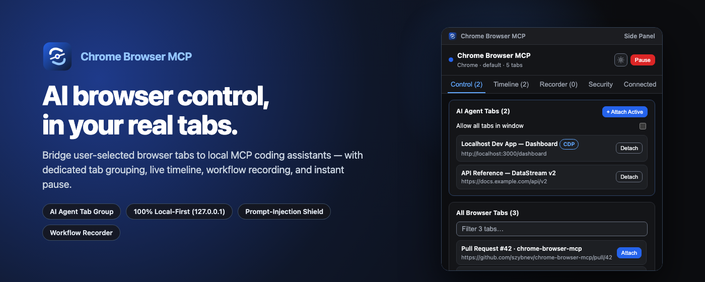
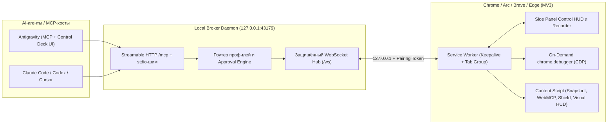

<div align="center">



# Chrome Browser MCP

**Расширение Chrome (MV3) и MCP v2 сервер нового поколения для AI browser use в реальных сессиях**

Гибридный Content Script + On-Demand CDP · Нативный WebMCP · Prompt-Injection Shield · Запись воркфлоу · Мультипрофильный брокер · MCP App Control Deck для Antigravity

[English](./README.md) · **Русский** · [简体中文](./README.zh-CN.md)

[](https://github.com/szybnev/chrome-browser-mcp/actions/workflows/ci.yml)
[](https://modelcontextprotocol.io)
[](./packages/extension)
[](./packages/extension/src/background/service-worker.ts)
[](./package.json)
[](./tsconfig.base.json)
[](./PRIVACY.md)
[](./packages/protocol/src/shield.ts)
[](./LICENSE)
[](https://github.com/szybnev/chrome-browser-mcp/stargazers)

</div>

---

## Зачем нужен Chrome Browser MCP?

Существующие решения для browser use часто заставляют мириться с компромиссами: либо запускают отдельный разлогиненный headless-браузер, либо постоянно держат жёлтую плашку Chrome о подключённом дебаггере, либо сжигают десятки тысяч токенов на скриншотах и сыром HTML, либо падают при запуске двух агентов одновременно и не защищают личные вкладки от prompt injection.

| Возможность | Chrome Browser MCP | Обычные релеи и визуальные расширения |
| :--- | :--- | :--- |
| **Реальные сессии и логины** | Работает в вашем основном профиле Chrome / Arc / Brave / Edge — без костылей с `--remote-debugging-port` | Часто нужен отдельный debug-профиль без кук и авторизаций |
| **Гибридный адаптивный движок** | Тихий Content Script + WebMCP по умолчанию; **on-demand `chrome.debugger` (CDP)** с авто-отключением по простою и fallback при открытом DevTools | Постоянная жёлтая плашка дебаггера или хрупкие синтетические клики |
| **Экономия токенов** | Компактный a11y/DOM-снапшот с короткими `ref` (`e1`, `e2`…), **инкрементальные диффы** и **batch-выполнение `browser_act`** (целая форма за 1 вызов) | Полный DOM/скриншот на каждом шаге и отдельный вызов LLM на каждый клик |
| **Несколько агентов и профилей** | Общий локальный Broker Daemon (Streamable HTTP + авто-запускаемый `stdio`-шим с lease-моделью) для параллельной работы агентов и браузеров | Конфликт портов (`EADDRINUSE`) при 2+ клиентах |
| **Безопасность и контроль** | Выделенная цветная группа вкладок **AI Agent**, редактируемый blocklist доменов, подтверждение опасных действий, **Prompt-Injection Shield**, мгновенная пауза `Alt+Shift+P` | Неограниченный доступ ко всем вкладкам или подтверждение на каждый клик |
| **WebMCP и запись воркфлоу** | Автообнаружение `navigator.modelContext` + режим «покажи руками» (Workflow Recorder с маскированием паролей) | Только ручные клики по DOM |
| **UI внутри Antigravity (MCP App)** | Встроенный **Browser Control Deck** (`ui://chrome-browser/deck.html`) в боковой панели (`aux_pane`) и глобальном виде (`global`) | Только текстовые ответы инструментов |

---

## Сравнение с другими браузерными расширениями

В экосистеме уже есть несколько сильных расширений и MCP-мостов для AI browser use — каждое оптимизировано под свой сценарий. Ниже приведено техническое сравнение по критериям, наиболее важным для работы AI-агентов в реальном браузере.

| Критерий | **Chrome Browser MCP** | **Claude for Chrome** | **ChatGPT for Chrome** | **omp browser relay** | **Kimi Browser Ext.** | **Playwright MCP** (`--extension`) | **BrowserMCP** |
| :--- | :---: | :---: | :---: | :---: | :---: | :---: | :---: |
| **Open Source и лицензия** | ✅ MIT | ❌ Закрытый код | ❌ Закрытый код | ✅ Open source | ❌ Закрытый *(есть MCP-обёртки сообщества)* | ✅ Apache-2.0 | ✅ Open source |
| **Независимость от агента (MCP v2)** | ✅ Любой MCP-хост *(HTTP + `stdio` + Apps)* | ⚠️ Только Claude / Claude Code | ❌ Только ChatGPT | ⚠️ `omp` CLI / сырой CDP-релей | ⚠️ Экосистема Kimi *(+ обёртки)* | ✅ Любой MCP-хост | ✅ Любой MCP-хост |
| **Реальные сессии и логины** | ✅ Основной профиль *(Chrome/Arc/Brave/Edge)* | ✅ Основной профиль | ✅ Основной профиль | ✅ Основной профиль *(обход блока Chrome 136+)* | ✅ Основной профиль | ⚠️ Ручной *«Share This Tab»* *(по умолчанию изолирован)* | ✅ Основной профиль |
| **Без постоянной жёлтой плашки CDP** | ✅ Гибрид CS + WebMCP; **on-demand CDP** с авто-отключением | ❌ Постоянная плашка CDP | ⚠️ Права отладчика браузера | ❌ Постоянный `chrome.debugger` | ❌ Постоянный `chrome.debugger` | ❌ Постоянный `chrome.debugger` | ❌ Постоянный `chrome.debugger` |
| **Работа при открытом DevTools** | ✅ Fallback на Content Script | ❌ Конфликт CDP | ⚠️ Ограничено | ❌ Конфликт единственного дебаггера | ❌ Конфликт единственного дебаггера | ❌ Конфликт единственного дебаггера | ❌ Конфликт единственного дебаггера |
| **Экономия токенов (Diffs и Batch)** | ✅ Короткие `ref` + **инкрементальные диффы** + **batch-действия** | ⚠️ Полные снапшоты / скриншоты | ⚠️ Управляется сервером | ⚠️ Сырой CDP *(зависит от клиента)* | ⚠️ Markdown/CSV, без диффов | ⚠️ Полное a11y-дерево на шаг; 1 клик/вызов | ⚠️ Полный ARIA-снапшот; 1 клик/вызов |
| **Мультиагентность и мультипрофильность** | ✅ Общий Broker Daemon *(lease + именованные профили)* | ❌ Одна сессия Claude | ❌ Одна сессия ChatGPT | ✅ Глобальный демон + Puppeteer mux | ❌ Один локальный мост | ⚠️ Одна выбранная вкладка в bridge-режиме | ❌ Один WS-порт / клиент |
| **Изоляция вкладок и контроль** | ✅ Группа **AI Agent**, blocklist, approvals, пауза `Alt+Shift+P` | ⚠️ Группа вкладок + частые запросы на каждый сайт | ⚠️ Запросы на чувствительных страницах | ❌ Базовое подключение релея | ⚠️ Базовый контроль в сайдбаре | ⚠️ Только ручной выбор вкладки | ⚠️ Ручное подключение в popup |
| **Защита от Prompt Injection** | ✅ Локальный санитайзер DOM и фильтр скрытого текста | ⚠️ Только на стороне модели | ⚠️ Только на стороне модели | ❌ Нет | ❌ Нет | ❌ Нет | ❌ Нет |
| **Нативный WebMCP (`navigator.modelContext`)** | ✅ Встроенное обнаружение и вызов | ❌ Нет | ❌ Нет | ❌ Нет | ❌ Нет | ❌ Нет | ❌ Нет |
| **Запись воркфлоу («покажи руками»)** | ✅ Рекордер в Side Panel *(маскирование паролей + повтор)* | ⚠️ Сохранённые промпты / шорткаты | ❌ Нет | ❌ Нет | ✅ Запись Skills / CLI-сценариев | ❌ Отдельный `codegen` | ❌ Нет |
| **100% Local-First без облачного аккаунта** | ✅ `127.0.0.1` + токен, 0 телеметрии | ❌ Нужен аккаунт Anthropic | ❌ Нужен аккаунт OpenAI | ✅ 100% локально | ⚠️ Локальный мост; для сайдбара нужен аккаунт Kimi | ✅ 100% локально | ✅ 100% локально |

### Что выбрать под вашу задачу

- **Выбирайте Chrome Browser MCP**, если вам нужен **open-source, независимый от вендора MCP v2**-мост в ваш реальный залогиненный браузер — с параллельной работой нескольких агентов, экономией токенов за счёт диффов и batch-действий, тихим режимом без постоянной плашки дебаггера, защитой от prompt injection, нативным WebMCP и строгой локальностью (`127.0.0.1`).
- **Выбирайте Claude for Chrome** или **ChatGPT for Chrome**, если вы работаете исключительно внутри экосистемы Anthropic или OpenAI и хотите запуск «из коробки» без локального CLI/брокера, жертвуя совместимостью с другими MCP-агентами.
- **Выбирайте omp browser relay**, если вы пользуетесь агентом `oh-my-pi` (`omp`) и вам нужен именно низкоуровневый CDP/Puppeteer-мультиплексор поверх реального профиля Chrome.
- **Выбирайте Kimi Browser Extension**, если ваш основной рабочий процесс построен вокруг сайдбара Kimi, Kimi Work и экосистемы Kimi Skills.
- **Выбирайте Playwright MCP (изолированный режим)** для воспроизводимых headless/E2E-тестов и CI-пайплайнов, где личные куки и сессии намеренно *не* нужны.
- **Выбирайте Chrome DevTools MCP (`chrome-devtools-mcp`)** *(CLI/CDP-сервер без расширения)*, если главная задача — глубокое профилирование производительности фронтенда (трассировки Core Web Vitals, heap-снапшоты, аудит Lighthouse), а не повседневная работа в авторизованных вкладках.

> *Срез на конец 2026 года. Инструменты для AI browser use быстро развиваются — если какие-то данные устарели, мы всегда рады PR с уточнениями.*

---

## Архитектура



---

## Быстрый старт

### 1. Сборка из исходников
```bash
git clone https://github.com/szybnev/chrome-browser-mcp.git
cd chrome-browser-mcp
pnpm install
pnpm build
```

### 2. Установка расширения Chrome (MV3)
1. Откройте `chrome://extensions` и включите **Режим разработчика (Developer mode)**.
2. Нажмите **Загрузить распакованное расширение (Load unpacked)** и выберите `packages/extension/dist`.
3. Кликните по иконке **Chrome Browser MCP** на панели браузера, чтобы открыть **Control HUD** в боковой панели.

### 3. Подключение к локальному брокеру (PIN в 1 клик или токен)
Сгенерируйте одноразовый 6-значный PIN на 2 минуты (используется в стартовом мастере настройки и вкладке Pair):
```bash
node packages/server/dist/cli.js pair
```
Введите 6-значный PIN в **Welcome Tour** или вкладке **Связь (Pair)** боковой панели Chrome (либо раскройте **Расширенное подключение**, чтобы вставить статический токен из `cli.js token`).

### 4. Подключение AI-агента

#### Antigravity (Плагин + MCP App Control Deck + Skill)
Подключите `plugins/antigravity` в `~/.gemini/config/plugins/chrome-browser-mcp`:
```bash
ln -s "$(pwd)/plugins/antigravity" ~/.gemini/config/plugins/chrome-browser-mcp
```
Antigravity автоматически подхватит:
- MCP-сервер (`chrome-browser-mcp_browser`)
- Интерактивную панель **Browser Control Deck** в меню `+` боковой панели (`aux_pane`) и в левом сайдбаре (`global`)
- Скилл `chrome-browser-mcp` с оптимальной стратегией работы агента

#### Claude Code / Cursor / Codex (`stdio` с общим брокером)
Добавьте в конфигурацию MCP (`mcp_config.json`, `.mcp.json` и т.д.):
```json
{
  "mcpServers": {
    "chrome-browser": {
      "command": "node",
      "args": ["/абсолютный/путь/к/chrome-browser-mcp/packages/server/dist/cli.js", "stdio"]
    }
  }
}
```
Несколько MCP-клиентов автоматически разделяют один локальный Broker Daemon через lease-механизм.

#### Streamable HTTP MCP (стандарт 2026)
Запустите демон напрямую:
```bash
node packages/server/dist/cli.js daemon
```
Подключайте любой Streamable HTTP MCP-клиент к `http://127.0.0.1:43179/mcp`.

---

## Каталог MCP-инструментов

| Инструмент | Назначение |
| :--- | :--- |
| `browser_profiles` | Список подключённых браузеров/профилей (Chrome/Arc/Brave/Edge) и выбор профиля по умолчанию |
| `browser_tabs` | Список, открытие, фокус, закрытие, подключение/отключение вкладок группы **AI Agent** |
| `browser_navigate` | Переход по URL, назад/вперёд, обновление, ожидание селектора или текста |
| `browser_snapshot` | Компактный a11y/DOM-снапшот по основному фрейму, cross-origin `iframe` (`f<id>:e1`) и Shadow DOM, режим **diff** и **Prompt-Injection Shield** |
| `browser_read` | Извлечение чистого Markdown, структурированных HTML-таблиц (`tables_csv` / `tables_json`) или текста PDF с пагинацией и фильтрацией скрытого DOM |
| `browser_screenshot` | Сжатый WebP/JPEG/PNG скриншот с опциональной разметкой **Set-of-Mark** и параметром `maxWidth` |
| `browser_act` | Выполнение одного действия или **batch-цепочки** (`click`, `fill`, `type`, `press`, `select`, `check`, `scroll`, `hover`, `drag`, `upload`, `wait`) с **Zero-Secret `secretRef`**, опциональным визуальным курсором и авто-диффом |
| `browser_dialog` | Проверка, подтверждение или отклонение нативных JS-диалогов `alert` / `confirm` / `prompt` / `beforeunload` без зависания вкладки |
| `browser_downloads` | Список последних загрузок или ожидание завершения скачивания (опциональное право `downloads`) |
| `browser_emulate` | Эмуляция мобильных/десктопных экранов (`iphone-15`, `pixel-9`, `ipad`, `reset`), темы `light`/`dark`, сети (`slow-3g`/`offline`) и геолокации |
| `browser_console` | Чтение логов консоли, предупреждений и необработанных исключений |
| `browser_network` | Инспекция XHR/Fetch-запросов и ошибок, а также чтение тела ответа с редакцией секретов (`includeBodyForRequestId`) |
| `browser_eval` | Выполнение JS в контексте страницы через CDP (с подтверждением на новых и Read-Only доменах) |
| `browser_audit` / `browser_audit_export` | Аудит a11y/CWV/storage и экспорт самодостаточного **JSON / HTML Session Replay** отчёта |
| `browser_webmcp_list` / `browser_webmcp_call` | Обнаружение и вызов клиентских WebMCP-инструментов (`navigator.modelContext`) |
| `browser_workflows` | Просмотр, параметризованный запуск (`{{variables}}`) и экспорт записанных сценариев в **Playwright `.spec.ts`** |
| `browser_deck` | Открытие или обновление интерактивного MCP App **Browser Control Deck** (EN / RU / 中文, Dark / Light) |

---

## Безопасность, аудит зависимостей и Git-хуки

При выполнении `pnpm install` автоматически подключаются локальные Git-хуки (`core.hooksPath = .githooks`):

- **`pre-commit`**: проверяет индексированные файлы на утечку секретов/ключей и небезопасные паттерны (`eval`, `innerHTML`, биндинг на `0.0.0.0`, откат к MV2), проверяет lockfile и CVE при изменении зависимостей, запускает `pnpm typecheck` и `pnpm test`.
- **`pre-push`**: запускает полный скан безопасности репозитория, проверку `sha512`-хешей и доверенных реестров в `pnpm-lock.yaml`, поиск подозрительных `preinstall`/`install`/`postinstall` скриптов, `pnpm audit --audit-level=moderate`, а также полную проверку типов, сборку и автотесты.
- **`pnpm-workspace.yaml`**: включает `blockExoticSubdeps: true` и строгий белый список `allowBuilds` (только `esbuild`).

---

## Разработка и тестирование

```bash
pnpm security:check  # Скан секретов + статические правила + supply-chain проверка + pnpm audit
pnpm typecheck       # Строгая проверка TypeScript во всех 4 пакетах
pnpm build           # Сборка protocol -> mcp-app -> server (встраивает deck.html) -> extension
pnpm test            # Unit- и live integration-тесты (Vitest)
pnpm pack:cws        # Сборка чистого ZIP-архива для Chrome Web Store в release/
```

## Лицензия
MIT — см. [LICENSE](./LICENSE).
