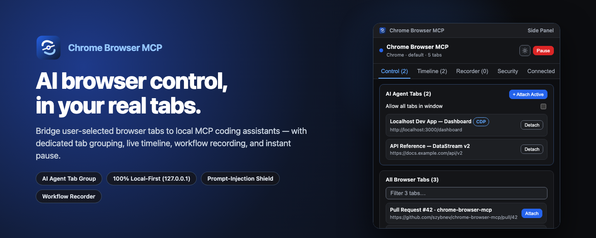
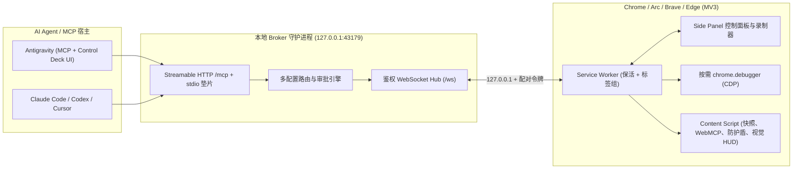

<div align="center">



<br /><br />

# Chrome Browser MCP

**面向真实浏览器会话的新一代 Chrome 扩展 (MV3) 与 MCP v2 服务器**

混合 Content Script + 按需 CDP · 原生 WebMCP · 提示词注入防护 · 工作流录制 · 多浏览器/多配置文件路由 · Antigravity Control Deck MCP App

[English](./README.md) · [Русский](./README.ru.md) · **简体中文**

[](https://github.com/szybnev/chrome-browser-mcp/actions/workflows/ci.yml)
[](https://modelcontextprotocol.io)
[](./packages/extension)
[](./packages/extension/src/background/service-worker.ts)
[](./package.json)
[](./tsconfig.base.json)
[](./PRIVACY.md)
[](./packages/protocol/src/shield.ts)
[](./LICENSE)
[](https://github.com/szybnev/chrome-browser-mcp/stargazers)

</div>

---

## 为什么选择 Chrome Browser MCP？

现有的 AI 浏览器自动化扩展往往存在明显痛点：要么启动未登录的无头浏览器，要么一直显示 Chrome 黄色调试横幅，要么每步发送巨量截图/原始 HTML 浪费数万 Token，要么多个 Agent 同时连接时发生端口冲突，或者将所有私密标签页暴露给网页提示词注入风险。

| 核心能力 | Chrome Browser MCP | 常见中继 / 视觉浏览器扩展 |
| :--- | :--- | :--- |
| **真实登录会话** | 直接运行在日常使用的 Chrome / Arc / Brave / Edge 配置文件中，无需 `--remote-debugging-port` | 通常需要单独调试配置或丢失登录状态 |
| **混合自适应引擎** | 默认使用无感 Content Script + WebMCP；仅在需要时**按需挂载 `chrome.debugger` (CDP)**，空闲自动断开，且兼容手动打开 DevTools | 始终显示黄色调试横幅，或合成点击不稳定 |
| **极致 Token 效率** | 精简无障碍/DOM 快照与短引用（`e1`, `e2`…）、**增量 Diff**，以及**批量 `browser_act`**（单次调用填完表单并提交） | 每步拉取完整 DOM/截图，每次点击都消耗一次模型往返 |
| **多 Agent 与多配置** | 共享本地 Broker 守护进程（Streamable HTTP + 自动拉起的租约式 `stdio` 垫片），支持多 Agent 与多浏览器并发复用 | 多客户端冲突（`EADDRINUSE`） |
| **安全与人工可控** | 独立彩色 **AI Agent 标签组**、可编辑域名黑名单、敏感操作审批门控、**Prompt-Injection Shield**、`Alt+Shift+P` 一键紧急暂停 | 无隔离的全浏览器访问或过度弹窗干扰 |
| **WebMCP 与工作流录制** | 原生发现并调用 `navigator.modelContext` 网页工具 + 侧边栏“手把手演示”工作流录制（自动掩码密码） | 只能逐元素手动点击 |
| **Antigravity MCP App 面板** | 内置 **Browser Control Deck**（`ui://chrome-browser/deck.html`），支持 `aux_pane` 侧边栏与 `global` 全局视图 | 仅返回纯文本结果 |

---

## 系统架构



---

## 快速开始

### 1. 从源码构建
```bash
git clone https://github.com/szybnev/chrome-browser-mcp.git
cd chrome-browser-mcp
pnpm install
pnpm build
```

### 2. 加载 Chrome 扩展 (MV3)
1. 打开 `chrome://extensions` 并开启 **开发者模式 (Developer mode)**。
2. 点击 **加载已解压的扩展程序 (Load unpacked)**，选择 `packages/extension/dist`。
3. 点击浏览器工具栏中的 **Chrome Browser MCP** 图标打开 **Control HUD** 侧边栏。

### 3. 与本地 Broker 配对
查看或生成本地回环配对令牌：
```bash
node packages/server/dist/cli.js token
```
在 Chrome 侧边栏切换到 **Pair** 标签页，粘贴令牌，设置配置文件名称（例如 `work`），点击 **Save & Connect**。

### 4. 连接你的 AI Agent

#### Antigravity（插件 + Browser Control Deck MCP App + Skill）
将 `plugins/antigravity` 链接到 `~/.gemini/config/plugins/chrome-browser-mcp`：
```bash
ln -s "$(pwd)/plugins/antigravity" ~/.gemini/config/plugins/chrome-browser-mcp
```
Antigravity 将自动发现：
- MCP 服务器（`chrome-browser-mcp_browser`）
- 侧边栏 `+` 菜单（`aux_pane`）和左侧导航栏（`global`）中的 **Browser Control Deck** 交互界面
- `chrome-browser-mcp` 最佳实践 Skill 指南

#### Claude Code / Cursor / Codex（`stdio` 自动共享 Broker）
在你的 MCP 配置文件（`mcp_config.json`、`.mcp.json` 等）中加入：
```json
{
  "mcpServers": {
    "chrome-browser": {
      "command": "node",
      "args": ["/绝对路径/chrome-browser-mcp/packages/server/dist/cli.js", "stdio"]
    }
  }
}
```
多个 MCP 客户端将通过租约心跳自动共享同一个本地 Broker 守护进程。

#### Streamable HTTP MCP（2026 标准）
直接启动守护进程：
```bash
node packages/server/dist/cli.js daemon
```
将任意支持 Streamable HTTP 的 MCP 客户端连接到 `http://127.0.0.1:43179/mcp`。

---

## MCP 工具一览

| 工具名称 | 功能说明 |
| :--- | :--- |
| `browser_profiles` | 列出已连接的 Chrome/Arc/Brave/Edge 配置文件并切换默认配置 |
| `browser_tabs` | 列出、打开、聚焦、关闭，或将标签页加入/移出 **AI Agent** 标签组 |
| `browser_navigate` | 打开 URL、前进/后退、刷新，或等待选择器/文本出现 |
| `browser_snapshot` | 生成带短引用（`e1`, `e2`…）的精简无障碍/DOM 快照，支持增量 **diff** 模式与 **Prompt-Injection Shield** |
| `browser_read` | 过滤隐藏 DOM 并提取干净可读的 Markdown 内容 |
| `browser_screenshot` | 捕获压缩 WebP/JPEG/PNG 截图，可选叠加 **Set-of-Mark** 元素编号标签 |
| `browser_act` | 单次调用执行单个操作或**批量操作序列**（`click`/`fill`/`type`/`press`/`select`/`check`/`scroll`/`hover`/`drag`/`wait`）并返回最新 diff 快照 |
| `browser_console` | 获取浏览器控制台日志、警告及未捕获异常 |
| `browser_network` | 检查 XHR/Fetch 网络请求与失败详情（自动脱敏敏感请求头） |
| `browser_eval` | 通过 CDP 在页面上下文执行 JavaScript（新域名默认触发人工审批） |
| `browser_audit` | 快速执行无障碍（a11y）、Core Web Vitals（LCP/CLS）及存储键审计 |
| `browser_webmcp_list` / `browser_webmcp_call` | 发现并调用页面暴露的客户端 WebMCP 工具（`navigator.modelContext`） |
| `browser_workflows` | 列出、查看并回放在侧边栏手动录制的工作流 |
| `browser_deck` | 打开或刷新交互式 **Browser Control Deck** MCP App |

---

## 安全校验、供应链防护与 Git 钩子

执行 `pnpm install` 时会自动配置 `core.hooksPath = .githooks`：

- **`pre-commit`**：扫描暂存区中的密钥/凭据泄露与高危模式（`eval`、`innerHTML`、`0.0.0.0` 监听、MV2 回退），当依赖变更时校检 lockfile 与 CVE，随后运行 `pnpm typecheck` 与 `pnpm test`。
- **`pre-push`**：执行全仓库安全扫描、校验 `pnpm-lock.yaml` 中的 `sha512` 校验和与官方 npm 源、检测可疑的 `preinstall`/`install`/`postinstall` 供应链投毒脚本、运行 `pnpm audit --audit-level=moderate`，以及完整类型检查、构建与测试。
- **`pnpm-workspace.yaml`**：启用 `blockExoticSubdeps: true` 与严格的 `allowBuilds` 白名单（仅允许 `esbuild`）。

---

## 开发与测试命令

```bash
pnpm security:check  # 密钥扫描 + 静态安全规则 + 供应链完整性校验 + pnpm audit
pnpm typecheck       # 全部 4 个工作区包的严格 TypeScript 类型检查
pnpm build           # 依次构建 protocol -> mcp-app -> server (打包 deck.html) -> extension
pnpm test            # 运行 Vitest 单元测试与 Broker/MCP 集成测试
pnpm pack:cws        # 在 release/ 目录打包干净的 Chrome Web Store ZIP 安装包
```

## 开源协议
MIT — 详见 [LICENSE](./LICENSE)。
