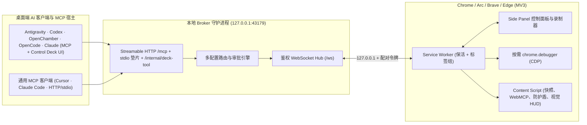

<div align="center">


# Chrome Browser MCP

**面向真实浏览器会话的新一代 Chrome 扩展 (MV3) 与 MCP v2 服务器**

混合 Content Script + 按需 CDP · 原生 WebMCP · 提示词注入防护 · 工作流录制 · 多浏览器/多配置文件路由 · 统一 Browser Control Deck 界面（Antigravity · Codex · OpenChamber · OpenCode · Claude）

[English](./README.md) · [Русский](./README.ru.md) · **简体中文**

[](https://github.com/szybnev/chrome-browser-mcp/actions/workflows/ci.yml)
[](https://modelcontextprotocol.io)
[](./packages/extension)
[](./packages/extension/src/background/service-worker.ts)
[](./package.json)
[](./tsconfig.base.json)
[](./PRIVACY.md)
[](./packages/protocol/src/shield.ts)
[](./LICENSE)
[](https://github.com/szybnev/chrome-browser-mcp/stargazers)

</div>

---

## 为什么选择 Chrome Browser MCP？

现有的 AI 浏览器自动化扩展往往存在明显痛点：要么启动未登录的无头浏览器，要么一直显示 Chrome 黄色调试横幅，要么每步发送巨量截图/原始 HTML 浪费数万 Token，要么多个 Agent 同时连接时发生端口冲突，或者将所有私密标签页暴露给网页提示词注入风险。

| 核心能力                     | Chrome Browser MCP                                                                                                          | 常见中继 / 视觉浏览器扩展                         |
| :--------------------------- | :-------------------------------------------------------------------------------------------------------------------------- | :------------------------------------------------ |
| **真实登录会话**             | 直接运行在日常使用的 Chrome / Arc / Brave / Edge 配置文件中，无需 `--remote-debugging-port`                                 | 通常需要单独调试配置或丢失登录状态                |
| **混合自适应引擎**           | 默认使用无感 Content Script + WebMCP；仅在需要时**按需挂载 `chrome.debugger` (CDP)**，空闲自动断开，且兼容手动打开 DevTools | 始终显示黄色调试横幅，或合成点击不稳定            |
| **极致 Token 效率**          | 精简无障碍/DOM 快照与短引用（`e1`, `e2`…）、**增量 Diff**，以及**批量 `browser_act`**（单次调用填完表单并提交）             | 每步拉取完整 DOM/截图，每次点击都消耗一次模型往返 |
| **多 Agent 与多配置**        | 共享本地 Broker 守护进程（Streamable HTTP + 自动拉起的租约式 `stdio` 垫片），支持多 Agent 与多浏览器并发复用                | 多客户端冲突（`EADDRINUSE`）                      |
| **安全与人工可控**           | 独立彩色 **AI Agent 标签组**、可编辑域名黑名单、敏感操作审批门控、**Prompt-Injection Shield**、`Alt+Shift+P` 一键紧急暂停   | 无隔离的全浏览器访问或过度弹窗干扰                |
| **WebMCP 与工作流录制**      | 原生发现并调用 `navigator.modelContext` 网页工具 + 侧边栏“手把手演示”工作流录制（自动掩码密码）                             | 只能逐元素手动点击                                |
| **主流桌面端原生界面**       | 为 **Google Antigravity**、**Codex Desktop**、**OpenChamber Desktop**、**OpenCode Desktop** 和 **Claude Desktop**（Code Mod + `.mcpb` MCP App）提供统一的 **Browser Control Deck** | 仅返回纯文本结果                                  |

---

## 与其他浏览器扩展的对比

目前 AI 浏览器自动化生态中已有不少优秀的扩展和 MCP 桥接工具，各自针对不同场景做了权衡。下表按真实会话 AI 浏览最关键的技术维度进行客观对比：

| 评估维度                                   |               **Chrome Browser MCP**                |    **Claude for Chrome**     | **ChatGPT for Chrome** |         **omp browser relay**         |      **Kimi Browser Ext.**      |   **Playwright MCP** (`--extension`)    |        **BrowserMCP**         |
| :----------------------------------------- | :-------------------------------------------------: | :--------------------------: | :--------------------: | :-----------------------------------: | :-----------------------------: | :-------------------------------------: | :---------------------------: |
| **开源与许可证**                           |                       ✅ MIT                        |           ❌ 闭源            |        ❌ 闭源         |                ✅ 开源                |   ❌ 闭源 _(社区有 MCP 封装)_   |              ✅ Apache-2.0              |            ✅ 开源            |
| **不绑定模型/Agent (MCP v2)**              |     ✅ 任意 MCP 宿主 _(HTTP + `stdio` + Apps)_      | ⚠️ 仅限 Claude / Claude Code |    ❌ 仅限 ChatGPT     |     ⚠️ `omp` CLI / 原始 CDP 中继      |     ⚠️ Kimi 生态 _(+ 封装)_     |            ✅ 任意 MCP 宿主             |       ✅ 任意 MCP 宿主        |
| **真实登录会话**                           |        ✅ 日常配置 _(Chrome/Arc/Brave/Edge)_        |         ✅ 日常配置          |      ✅ 日常配置       | ✅ 日常配置 _(绕过 Chrome 136+ 限制)_ |           ✅ 日常配置           | ⚠️ 手动 _"Share This Tab"_ _(默认隔离)_ |          ✅ 日常配置          |
| **无常驻黄色调试横幅**                     |     ✅ 混合 CS + WebMCP；**按需 CDP** 空闲断开      |       ❌ 常驻 CDP 横幅       |   ⚠️ 浏览器调试权限    |       ❌ 常驻 `chrome.debugger`       |    ❌ 常驻 `chrome.debugger`    |        ❌ 常驻 `chrome.debugger`        |   ❌ 常驻 `chrome.debugger`   |
| **兼容手动打开 DevTools**                  |            ✅ 自动回退至 Content Script             |       ❌ CDP 挂载冲突        |        ⚠️ 受限         |            ❌ 单调试器冲突            |         ❌ 单调试器冲突         |             ❌ 单调试器冲突             |        ❌ 单调试器冲突        |
| **Token 效率（Diff 与批量）**              |     ✅ 精简引用 + **增量 Diff** + **批量操作**      |      ⚠️ 全量快照 / 截图      |     ⚠️ 服务端托管      |     ⚠️ 原始 CDP _(取决于客户端)_      |  ⚠️ Markdown/CSV 提取；无 Diff  |     ⚠️ 每步全量无障碍树；单步单调用     | ⚠️ 全量 ARIA 快照；单步单调用 |
| **多 Agent 与多配置并发**                  |     ✅ 共享 Broker 守护进程 _(租约 + 命名配置)_     |      ❌ 单 Claude 会话       |   ❌ 单 ChatGPT 会话   |   ✅ 全局守护进程 + Puppeteer 复用    |          ❌ 单本地桥接          |         ⚠️ 桥接模式仅单共享标签         |    ❌ 单 WS 端口 / 客户端     |
| **标签页隔离与人工可控**                   | ✅ **AI Agent** 标签组、黑名单、审批、`Alt+Shift+P` | ⚠️ 标签组 + 频繁逐站确认弹窗 |   ⚠️ 敏感页确认提示    |            ❌ 基础中继挂载            |     ⚠️ 基础侧边栏/桥接控制      |           ⚠️ 仅手动共享单标签           |        ⚠️ 弹窗手动连接        |
| **提示词注入防护**                         |        ✅ 本地非信任 DOM 净化 + 隐藏文本过滤        |    ⚠️ 仅服务端模型侧防护     | ⚠️ 仅服务端模型侧防护  |                 ❌ 无                 |              ❌ 无              |                  ❌ 无                  |             ❌ 无             |
| **原生 WebMCP (`navigator.modelContext`)** |                ✅ 内置自动发现与调用                |            ❌ 无             |         ❌ 无          |                 ❌ 无                 |              ❌ 无              |                  ❌ 无                  |             ❌ 无             |
| **工作流录制（“手把手演示”）**             |        ✅ 侧边栏录制 _(密码掩码 + MCP 回放)_        |   ⚠️ 保存提示词 / 快捷方式   |         ❌ 无          |                 ❌ 无                 |   ✅ 可复用 Skills / CLI 流程   |           ❌ 需另用 `codegen`           |             ❌ 无             |
| **100% 纯本地 / 无需云账号**               |            ✅ `127.0.0.1` + 令牌，零遥测            |     ❌ 需 Anthropic 账号     |   ❌ 需 OpenAI 账号    |             ✅ 100% 本地              | ⚠️ 本地桥接；侧边栏需 Kimi 账号 |              ✅ 100% 本地               |         ✅ 100% 本地          |

### 如何选择

- **选择 Chrome Browser MCP**：需要一个**开源、模型无关的 MCP v2** 真实浏览器扩展，兼顾多 Agent 并发、增量 Diff 与批量操作带来的低 Token 消耗、默认无常驻调试横幅、本地提示词注入防护、原生 WebMCP 与严格 `127.0.0.1` 隐私边界。
- **选择 Claude for Chrome / ChatGPT for Chrome**：只使用 Anthropic 或 OpenAI 自家生态，更看重免本地守护进程配置的开箱即用体验，而不需要跨 Agent 的 MCP 互通。
- **选择 omp browser relay**：深度使用 `oh-my-pi` (`omp`) 生态，且明确需要基于扩展的底层 CDP / Puppeteer 多路复用通道。
- **选择 Kimi Browser Extension**：日常工作流以 Moonshot Kimi 侧边栏、Kimi Work 与 Kimi Skills 为核心。
- **选择 Playwright MCP（隔离模式）**：用于可复现的无头/干净环境端到端测试与 CI 流水线，刻意*不*希望混入个人 Cookie 与登录态。
- **选择 Chrome DevTools MCP (`chrome-devtools-mcp`)** _(非扩展 CLI/CDP 服务)_：核心需求是前端深度性能分析（Core Web Vitals 追踪、堆快照、Lighthouse 审计），而非日常已登录网页的自动化操作。

> _对比基准截至 2026 年底。AI 浏览器工具迭代迅速，如表中信息有更新，欢迎提交 PR 保持准确。_

---

## 系统架构



---

## 快速开始

### 1. 从源码构建

```bash
git clone https://github.com/szybnev/chrome-browser-mcp.git
cd chrome-browser-mcp
pnpm install
pnpm build
```

### 2. 加载 Chrome 扩展 (MV3)

1. 打开 `chrome://extensions` 并开启 **开发者模式 (Developer mode)**。
2. 点击 **加载已解压的扩展程序 (Load unpacked)**，选择 `packages/extension/dist`。
3. 点击浏览器工具栏中的 **Chrome Browser MCP** 图标打开 **Control HUD** 侧边栏。

### 3. 与本地 Broker 配对（6 位 PIN 码一键配对或手动令牌）

生成有效期 2 分钟的 6 位一次性配对 PIN 码（推荐用于首次安装引导向导和侧边栏）：

```bash
node packages/server/dist/cli.js pair
```
在 **Welcome Tour** 或 Chrome 侧边栏 **配对 (Pair)** 标签页中输入 6 位 PIN 码（也可展开 **高级连接选项** 手动粘贴 `cli.js token` 的静态令牌）。

### 4. 连接你的桌面端 AI 客户端（Harness）

Chrome Browser MCP 为主流桌面端 AI 客户端提供原生 GUI 集成与统一的 **Browser Control Deck** 体验。所有客户端均连接至**同一个共享本地 Broker 守护进程**（`127.0.0.1:43179`），只需与 Chrome 配对一次，即可在各个桌面客户端间同时无缝控制实时标签页。

| 桌面端客户端 | 集成包路径 | Browser Control Deck 界面入口 | MCP 自动注册方式 |
| :--- | :--- | :--- | :--- |
| **Google Antigravity** | `plugins/antigravity/` | 侧边面板（`aux_pane`）+ 左侧导航栏（`global`）MCP App | `mcp_config.json` |
| **Codex Desktop** | `plugins/codex/` + `.agents/plugins/marketplace.json` | 会话侧边面板（`thread`）+ 全局侧边栏（`global`）MCP App | `mcp.json` / `.mcp.json` |
| **OpenChamber Desktop** (`>=2.5.0`) | `plugins/openchamber/` | 右侧边栏面板 + 全屏页面 + 实时 Work Status 状态条 + 侧栏待审批角标 | 内置 `opencodePlugin` |
| **OpenCode Desktop** (`>=2.2.0`) | `plugins/opencode/` | 原生侧边 `Panel`（Shadow DOM）+ 面板 `+` 菜单项（`session.panel`）+ 命令面板（`./gui-experimental`） | 服务端插件（`ctx.mcp.transform`） |
| **Claude Desktop** | `plugins/claude/` + `release/chrome-browser-mcp.mcpb` | **Code 标签页**：原生 5 标签页 Claude Mod `Pane`（`/browser-deck`）+ `AbovePrompt` 状态条<br>**Chat 标签页**：`.mcpb` 扩展包与内联 MCP App | `.mcp.json` / `.mcpb` |

> **自包含插件打包：** `pnpm build` 会在 `plugins/codex`、`plugins/openchamber` 和 `plugins/opencode` 内打包独立的服务端产物（`server/cli.js` + `server/app/deck.html`），**不依赖外部 `npx` 回退**；即使客户端将插件复制到仓库外的本地缓存或扩展目录中也能稳定运行。

#### 本地快速安装工具

预览或一键安装各桌面客户端的本地配置：

```bash
pnpm install:local --all --dry-run
# 或按需安装指定客户端：
pnpm install:local --antigravity --codex --opencode --openchamber --claude
```

#### Google Antigravity（插件 + Browser Control Deck MCP App + Skill）

将 `plugins/antigravity` 链接到 `~/.gemini/config/plugins/chrome-browser-mcp`（或运行 `pnpm install:local --antigravity`）：

```bash
ln -s "$(pwd)/plugins/antigravity" ~/.gemini/config/plugins/chrome-browser-mcp
```
Antigravity 将自动发现：

- MCP 服务器（`chrome-browser-mcp_browser`）
- 侧边栏 `+` 菜单（`aux_pane`）和左侧导航栏（`global`）中的 **Browser Control Deck** 交互界面
- `chrome-browser-mcp` 最佳实践 Skill 指南

#### Codex Desktop（Codex 插件 + Global 与 Thread MCP App）

在 `~/.codex/config.toml` 中将本仓库注册为本地市场（或运行 `pnpm install:local --codex`，同时自动刷新 Codex 本地插件缓存）：

```toml
[marketplaces.chrome-browser-mcp]
source_type = "local"
source = "/绝对路径/chrome-browser-mcp"

[plugins."chrome-browser-mcp@chrome-browser-mcp"]
enabled = true
```

Codex Desktop 会加载 `plugins/codex/`，在全局侧边栏（`openai/ui: global`）和每个会话的侧边面板（`openai/ui: thread`）中提供 **Browser Control Deck**，同时注册全部 `browser_*` 工具与 `chrome-browser-mcp` Skill。

#### OpenChamber Desktop（右侧边栏扩展 + Work Status + 自动注册 MCP）

1. 打开 **OpenChamber → Settings → Extensions**。
2. 点击 **Add** 并填写本地目录路径 `/绝对路径/chrome-browser-mcp/plugins/openchamber`（或通过 Git URL 安装）。
3. 批准本地回环服务代理与内置的 OpenCode 插件。

OpenChamber 会在右侧边栏与 Pages 中挂载完整的 **Browser Control Deck**，提供带 Pause/Resume/PIN 控制按钮的实时 **Work Status** 状态条与待审批角标，并在 OpenChamber 的 OpenCode 服务中自动注册 `chrome-browser` MCP 工具。

#### OpenCode Desktop（`@opencode/plugin/gui` 侧边面板 + 自动注册 MCP）

在全局 `~/.config/opencode/opencode.json` 中添加 `plugins/opencode`（或运行 `pnpm install:local --opencode`）：

```json
{
  "plugins": ["/绝对路径/chrome-browser-mcp/plugins/opencode"]
}
```

OpenCode Desktop 会加载服务端插件（通过 `ctx.mcp.transform` 自动注册 `chrome-browser` MCP 工具）和 `./gui-experimental` 桌面端包，添加 **Browser Control Deck** 侧边面板、面板 `+` 菜单项、命令面板快捷操作（`⌘⇧P` → `Open Browser Control Deck`）以及侧边栏切换按钮。

#### Claude Desktop（Code 标签页 Claude Mod + Chat 标签页 `.mcpb`）

- **Code 标签页（Claude Mod）：** 将 `plugins/claude/` 作为插件目录加载。随时运行 `/browser-deck`（甚至在对话执行中途）即可打开原生 5 标签页 **Browser Control Deck** 侧边面板，并配合 `AbovePrompt` 状态条一键批准/拒绝敏感操作或暂停。
- **Chat 标签页（`.mcpb` MCP Bundle）：** 运行 `pnpm pack:mcpb` 生成 `release/chrome-browser-mcp.mcpb`，将其拖入 **Claude Desktop → Settings → Extensions** 即可使用全部 `browser_*` 工具与内联 `browser_deck` MCP App。

#### 通用 MCP 客户端（`stdio` 自动共享 Broker）

在你的 MCP 配置文件（`mcp_config.json`、`.mcp.json` 等）中加入：

```json
{
  "mcpServers": {
    "chrome-browser": {
      "command": "node",
      "args": ["/绝对路径/chrome-browser-mcp/packages/server/dist/cli.js", "stdio"]
    }
  }
}
```
多个 MCP 客户端将通过租约心跳自动共享同一个本地 Broker 守护进程。

#### Streamable HTTP MCP（2026 标准）

直接启动守护进程：

```bash
node packages/server/dist/cli.js daemon
```
将任意支持 Streamable HTTP 的 MCP 客户端连接到 `http://127.0.0.1:43179/mcp`。

---

## MCP 工具一览

| 工具名称                                      | 功能说明                                                                                                                                                                        |
| :-------------------------------------------- | :------------------------------------------------------------------------------------------------------------------------------------------------------------------------------ |
| `browser_profiles`                            | 列出已连接的 Chrome/Arc/Brave/Edge 配置文件并切换默认配置                                                                                                                       |
| `browser_tabs`                                | 列出、打开、聚焦、关闭，或将标签页加入/移出 **AI Agent** 标签组                                                                                                                 |
| `browser_navigate`                            | 打开 URL、前进/后退、刷新，或等待选择器/文本出现                                                                                                                                |
| `browser_snapshot`                            | 跨主框架、跨域 `iframe`（`f<id>:e1`）与 Shadow DOM 的精简无障碍/DOM 快照，支持增量 **diff** 与 **Prompt-Injection Shield**                                                      |
| `browser_read`                                | 过滤隐藏 DOM，提取干净可读的 Markdown、结构化 HTML 表格（`tables_csv` / `tables_json`）或 PDF 文本，支持分页                                                                    |
| `browser_screenshot`                          | 捕获压缩 WebP/JPEG/PNG 截图，可选叠加 **Set-of-Mark** 元素编号与 `maxWidth` 缩放                                                                                                |
| `browser_act`                                 | 单次调用执行单个或**批量操作**（`click`/`fill`/`type`/`press`/`select`/`check`/`scroll`/`hover`/`drag`/`upload`/`wait`），支持 **Zero-Secret `secretRef`** 与可选页面可视化光标 |
| `browser_dialog`                              | 非阻塞查看、批准或取消原生 JS `alert` / `confirm` / `prompt` / `beforeunload` 弹窗                                                                                              |
| `browser_downloads`                           | 列出最近下载或等待下载完成（需按需授予可选 `downloads` 权限）                                                                                                                   |
| `browser_emulate`                             | 模拟移动端/桌面视口（`iphone-15` / `pixel-9` / `ipad` / `reset`）、明暗主题、弱网（`slow-3g` / `offline`）与地理位置                                                            |
| `browser_console`                             | 获取浏览器控制台日志、警告及未捕获异常                                                                                                                                          |
| `browser_network`                             | 检查 XHR/Fetch 网络请求与失败详情，并支持脱敏读取响应正文（`includeBodyForRequestId`）                                                                                          |
| `browser_eval`                                | 通过 CDP 在页面上下文执行 JavaScript（新域名与只读域名默认触发人工审批）                                                                                                        |
| `browser_audit` / `browser_audit_export`      | 执行 a11y/CWV/存储审计，并导出自包含 **JSON / HTML 会话回放**审计报告                                                                                                           |
| `browser_webmcp_list` / `browser_webmcp_call` | 发现并调用页面暴露的客户端 WebMCP 工具（`navigator.modelContext`）                                                                                                              |
| `browser_workflows`                           | 列出、查看、使用 `{{variables}}` 动态回放或导出为 **Playwright `.spec.ts`** 测试脚本                                                                                            |
| `browser_deck`                                | 打开或刷新交互式 **Browser Control Deck** MCP App（支持 EN / RU / 中文与深浅主题）                                                                                              |

---

## 安全校验、供应链防护与 Git 钩子

执行 `pnpm install` 时会自动配置 `core.hooksPath = .githooks`：

- **`pre-commit`**：扫描暂存区中的密钥/凭据泄露与高危模式（`eval`、`innerHTML`、`0.0.0.0` 监听、MV2 回退），当依赖变更时校检 lockfile 与 CVE，随后运行 `pnpm typecheck` 与 `pnpm test`。
- **`pre-push`**：执行全仓库安全扫描、校验 `pnpm-lock.yaml` 中的 `sha512` 校验和与官方 npm 源、检测可疑的 `preinstall`/`install`/`postinstall` 供应链投毒脚本、运行 `pnpm audit --audit-level=moderate`，以及完整类型检查、构建与测试。
- **`pnpm-workspace.yaml`**：启用 `blockExoticSubdeps: true` 与严格的 `allowBuilds` 白名单（仅允许 `esbuild`）。

---

## 仓库目录结构

```text
chrome-browser-mcp/
├── packages/
│   ├── protocol/      # 共享 Zod v4 Schema、RPC 协议封装、提示词注入防护盾、Diff 引擎
│   ├── server/        # 本地 Broker 守护进程（Streamable HTTP + stdio 垫片 + WS Hub + CLI）
│   ├── extension/     # Chrome MV3 扩展（Service Worker、按需 CDP、Content Script、HUD、侧边栏）
│   └── mcp-app/       # Browser Control Deck（React + @modelcontextprotocol/ext-apps + vite-plugin-singlefile）
├── plugins/
│   ├── antigravity/   # Antigravity 插件（plugin.json、mcp_config.json、SKILL.md、图标）
│   ├── codex/         # Codex Desktop 插件（Agent Plugins 1.0 + .codex-plugin + mcp.json + Skill）
│   ├── openchamber/   # OpenChamber Desktop 扩展（右侧面板、页面、Work Status、回环服务、内置 opencodePlugin）
│   ├── opencode/      # OpenCode Desktop 插件（MCP 自动注册 + ./gui-experimental 侧边面板）
│   └── claude/        # Claude Desktop Mod（5 标签页 Pane + AbovePrompt + .mcp.json）与 .mcpb 清单
├── .agents/plugins/   # Codex 本地市场根目录描述文件（marketplace.json）
├── scripts/           # 安全校验、桌面插件打包、本地安装脚本、.mcpb 与 Chrome Web Store 打包脚本
├── .githooks/         # 自动 pre-commit 与 pre-push 安全检查和测试钩子
├── CHROMEWEBSTORE.md  # Chrome Web Store 上架信息、权限说明与隐私披露
└── PRIVACY.md         # 本地优先隐私政策（零遥测）
```

---

## 开发与测试命令

```bash
pnpm security:check                 # 密钥扫描 + 静态安全规则 + 供应链完整性校验 + pnpm audit
pnpm check                          # Biome 代码规范与格式检查（零警告）
pnpm typecheck                      # 全部 4 个工作区包的严格 TypeScript 类型检查
pnpm build                          # 依次构建 protocol -> mcp-app -> server (deck.html) -> extension -> 桌面插件
pnpm build:plugins                  # 重新打包桌面端客户端插件（Codex、OpenChamber、OpenCode、Claude）
pnpm test                           # 运行 Vitest 单元测试、Broker/MCP 集成测试与桌面插件测试
pnpm install:local --all --dry-run  # 预览 Antigravity、Codex、OpenCode、OpenChamber 与 Claude 的本地安装配置
pnpm pack:mcpb                      # 在 release/ 目录打包 Claude Desktop Chat 标签页 .mcpb 扩展包
pnpm pack:cws                       # 在 release/ 目录打包干净的 Chrome Web Store ZIP 安装包
```

## 开源协议

MIT — 详见 [LICENSE](./LICENSE)。
